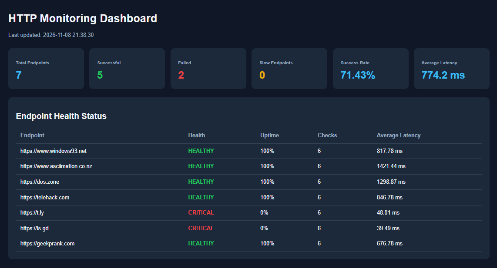
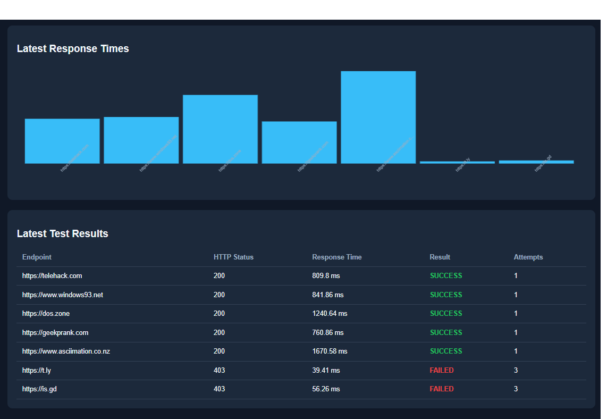

# smoketesting
A PowerShell Script for Smoke Testing

## How to execute
```prompt
# Check PowerShell version
$PSVersionTable.PSVersion

# Execute monitoring
pwsh -File .\PowerShellSmoke.ps1

# Open dashboard
Start-Process .\dashboard\index.html
```

# Dashboard




## Example: targets.txt
```prompt
https://www.windows93.net
https://www.asciimation.co.nz
https://dos.zone
https://telehack.com
https://t.ly 
https://is.gd
https://geekprank.com 
```


## Example output
```prompt
Starting HTTP smoke tests...
[SUCCESS] HTTP 200 | 809.8 ms | https://telehack.com                                                                    
[SUCCESS] HTTP 200 | 841.86 ms | https://www.windows93.net
[SUCCESS] HTTP 200 | 1240.64 ms | https://dos.zone
[SUCCESS] HTTP 200 | 760.86 ms | https://geekprank.com
[SUCCESS] HTTP 200 | 1670.58 ms | https://www.asciimation.co.nz
[FAILED] HTTP 403 | 39.41 ms | https://t.ly
[FAILED] HTTP 403 | 56.26 ms | https://is.gd
[INFO] CSV reports generated.
[INFO] Dashboard data prepared.
[INFO] HTML dashboard generated.

==========================================
       POWERSHELL HTTP MONITORING
             VERSION 5.0
==========================================

MONITORING SUMMARY
Total Targets:       7
Successful:          5
Failed:              2
Slow Endpoints:      0

PERFORMANCE METRICS
Success Rate:        71.43%
Average Latency:     774.2 ms
Historical Runs:     6
Execution Time:      3.35 seconds

GENERATED REPORTS
CSV Report:          .\reports\latest-results.csv
History:             .\reports\history.json
Dashboard:           .\dashboard\index.html

==========================================

[WARNING] Some endpoints failed.
```
